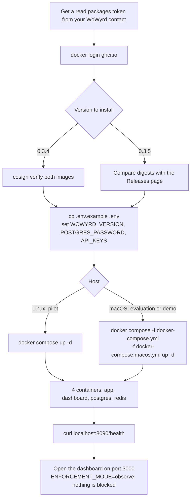
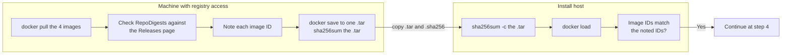

# WoWyrd — pilot install runbook

The authoritative, step-by-step install procedure for a PILOT-tier evaluation: shadow-mode only,
Full profile (PostgreSQL + Redis), no Kubernetes, no air-gapped delivery, no kernel-enforcement
packaging. `README.md` stays the general overview; this file is the one source of truth for "what
do I actually run" — update this file when the install procedure changes. Upgrade, backup,
rollback and uninstall are in [`OPERATIONS.md`](OPERATIONS.md).
[wowyrd.net/install/](https://wowyrd.net/install/) gives a short summary of these steps and
defers to this file. This file is the source of truth.

## Which profile to use

| | Full (PostgreSQL + Redis) | Lite (embedded SQLite) |
|---|---|---|
| Use it for | A pilot on your own data | A quick look only |
| Containers | 4: `wowyrd-app`, `wowyrd-dashboard`, `wowyrd-postgres`, `wowyrd-redis` | 2: `wowyrd-app`, `wowyrd-dashboard` |
| Transaction evaluation, case queue | Yes | Yes |
| Rule pack loaded | 41 rules in `v0.3.5`, 38 in `v0.3.4` | Same as Full |
| Detection | All loaded rules can fire | Not the same as Full (see below) |
| Evidence report, retro-analysis | Yes | Not available |
| Champion-challenger comparison | Yes | Not available |
| Manager KPIs, Author tab | Yes | Not available |
| Fraud feedback (`/v1/feedback`), confirmed-fraud import, payment callback | Yes | Not available |
| Step-up, webhooks, action gates | Yes | Not available |

A pilot needs the evidence report, so a pilot uses the Full profile. Steps 1–6 below install it.
The Lite profile returns a "not available in the embedded lite profile" error for every feature
marked "Not available". Rules that need dormancy or threat-indicator history (e.g. dormant-account
wake, known-bad indicator) may not fire on Lite, so detection is not the same as Full, even though
the same rule pack is loaded. Step 7 covers the Lite profile.

## Install flow



The diagram shows steps 1–5. Step 7 (Lite) is a separate quick look, not a pilot.

## 1. Prerequisites

- Docker + Docker Compose.
- A Linux host for a pilot. The Full profile runs `wowyrd-app` with host networking and
  privileged mode, for optional eBPF enforcement. eBPF is optional: without it (on a kernel older
  than 5.15, or with `NETWORK_INTERFACE` unset) WoWyrd runs in PostgreSQL-only mode.
- macOS is for evaluation or a demo only — see "macOS / Docker Desktop" at the end of step 4.
  Use the macOS overlay to evaluate WoWyrd on a Mac. Run a pilot on your own data on a Linux
  server.
- A GitHub Personal Access Token scoped to `read:packages` (your WoWyrd engineering contact
  issues this on request) — both images are private.
- `WOWYRD_VERSION` **0.3.4 or later.** `v0.3.4` is the first version published on this repo's
  Releases page. Earlier versions are not published here, and they are unsigned.

## 2. Authenticate to the image registry (one-time per machine)

```bash
echo "$WOWYRD_PAT" | docker login ghcr.io -u wowyrd --password-stdin
```

The registry checks the token only. The user name can be any value, and you don't need a GitHub
account of your own.

### Option B: a host without registry access

If the install host cannot reach `ghcr.io`, copy the images to it as one file.



On a machine with registry access (log in as above first, and do step 3 there):

1. Pull the four images:
   ```bash
   V=0.3.5
   docker pull ghcr.io/chavychaze/wowyrd-app:$V
   docker pull ghcr.io/chavychaze/wowyrd-dashboard:$V
   docker pull postgres:15-alpine
   docker pull redis:7-alpine
   ```
2. Show the digest and the ID of each WoWyrd image:
   ```bash
   for i in wowyrd-app wowyrd-dashboard; do
     docker image inspect ghcr.io/chavychaze/$i:$V --format '{{index .RepoDigests 0}}  {{.Id}}'
   done
   ```
   The digest must match the digest on the version's Releases page entry. Note each image ID.
3. Save the images to one file and make its checksum:
   ```bash
   docker save -o wowyrd-$V.tar ghcr.io/chavychaze/wowyrd-app:$V \
     ghcr.io/chavychaze/wowyrd-dashboard:$V postgres:15-alpine redis:7-alpine
   sha256sum wowyrd-$V.tar > wowyrd-$V.tar.sha256    # macOS: shasum -a 256
   ```
4. Copy `wowyrd-$V.tar` and `wowyrd-$V.tar.sha256` to the install host.

On the install host:

1. Check the file and load it:
   ```bash
   sha256sum -c wowyrd-$V.tar.sha256
   docker load -i wowyrd-$V.tar
   ```
2. Show the image IDs:
   ```bash
   docker image inspect ghcr.io/chavychaze/wowyrd-app:$V ghcr.io/chavychaze/wowyrd-dashboard:$V --format '{{.Id}}'
   ```
   Each ID must match the ID that you noted. After `docker load`, `RepoDigests` is empty. That is
   normal: `docker save` writes a new manifest, so the Releases page digest cannot be checked on
   this host. The image ID is the check here.
3. Continue at step 4. Compose uses the loaded images and does not try to pull them.

The `0.3.5` images are built for `linux/amd64` only.

## 3. Verify the images are genuinely signed by WoWyrd (recommended before first pull)

`v0.3.4` is signed with [cosign](https://docs.sigstore.dev/cosign/signing/overview/) using GitHub
Actions' own keyless/OIDC identity (Sigstore's public Fulcio/Rekor infrastructure) — no shared
signing key exists to leak or need rotating.

**`v0.3.5` is not signed.** Its images were built and pushed manually while the signed release
pipeline was unavailable. `cosign verify` fails against `0.3.5`, and that failure says nothing
about the images' integrity either way. Compare the image digests on the `v0.3.5` Releases page
entry instead. A future release will restore signing. Releases before `v0.3.4` are unsigned too.

To verify `0.3.4`, install cosign
([instructions](https://docs.sigstore.dev/cosign/system_config/installation/)), then:

```bash
cosign verify \
  --certificate-identity-regexp "^https://github.com/chavychaze/.*$" \
  --certificate-oidc-issuer "https://token.actions.githubusercontent.com" \
  ghcr.io/chavychaze/wowyrd-app:0.3.4

cosign verify \
  --certificate-identity-regexp "^https://github.com/chavychaze/.*$" \
  --certificate-oidc-issuer "https://token.actions.githubusercontent.com" \
  ghcr.io/chavychaze/wowyrd-dashboard:0.3.4
```

The image digests for each release are on its Releases page entry.

A Software Bill of Materials (CycloneDX format) for each image — `wowyrd-app.cdx.json` and
`bom.json` respectively — is attached to each release on this repo's Releases page for a
vendor-security review.

## 4. Configure and start (Full profile)

```bash
cp .env.example .env
# edit .env: set WOWYRD_VERSION=0.3.5 (drop the leading "v" — see README.md's
# "Versions" section), POSTGRES_PASSWORD, and API_KEYS.
# On an internet-facing host, also add POSTGRES_BIND=127.0.0.1 and REDIS_BIND=127.0.0.1, so the
# database and cache ports are not exposed (both default to 0.0.0.0).

docker compose up -d
```

This starts 4 containers. Confirm that directly:

```bash
docker compose ps   # expect wowyrd-app, wowyrd-dashboard, wowyrd-postgres, wowyrd-redis
```

### Optional: the datacenter ASN list

No image contains a datacenter ASN list. Without one, the `datacenter_asn` rule is off and never
fires. At start, the app logs "datacenter ASN list not loaded — datacenter_asn disabled". The
`datacenter_ip` rule does not need this list.

To turn the rule on:

1. Create `config/intel/datacenter-asns.txt`.
2. Write one ASN per line, as a number (for example `16509`). The app ignores blank lines and
   lines that start with `#`.
3. Send `client_asn` (a number) with each transaction to `POST /v1/evaluate`. The rule uses only
   this field.
4. Restart `wowyrd-app`. The app reads the list only at start.

### macOS / Docker Desktop (evaluation or demo only)

On Docker Desktop, the Full profile's host networking leaves `wowyrd-app`'s port 8090 unreachable
from the Mac itself, so the dashboard cannot reach the API. To run the Full profile on a Mac for
an evaluation or a demo, add the `docker-compose.macos.yml` overlay:

```bash
docker compose -f docker-compose.yml -f docker-compose.macos.yml up -d
```

The overlay moves `wowyrd-app` onto Compose's normal network and turns eBPF off. WoWyrd then runs
in PostgreSQL-only mode, with the same 4 containers and the same features as the Full profile on
Linux, except optional eBPF enforcement. Use the macOS overlay to evaluate WoWyrd on a Mac. Run a
pilot on your own data on a Linux server. The Lite profile (step 7) also runs on macOS.

## 5. Confirm shadow mode is running

```bash
curl http://localhost:8090/health
```

Open the dashboard at `http://localhost:3000` (or `http://<HOST_IP>:3000` if you set `HOST_IP` in
`.env`) and confirm it loads — shadow-mode evidence data will populate as real/synthetic traffic
is evaluated. `ENFORCEMENT_MODE` defaults to `observe` — nothing is ever blocked automatically.

## 6. If something doesn't work

Reach out to your WoWyrd engineering contact — this is a guided technical pilot, not a self-serve
product. If you're timing this install for the first time, please record: total wall-clock time,
and every step above that needed something not written down here, exactly as written — that
feedback is what keeps this runbook honest.

## 7. Quick look without a database (Lite profile — not for a pilot)

The Lite profile runs transaction evaluation and the case queue only. It has no evidence report,
so it cannot deliver a pilot's results — see "Which profile to use" above.

```bash
cp .env.example .env
# edit .env: set WOWYRD_VERSION=0.3.5, API_KEYS, and POSTGRES_PASSWORD to any placeholder value
# (this profile never connects to Postgres, but Compose still validates the variable exists —
# see docker-compose.lite.yml's own comment on why).

docker compose -f docker-compose.yml -f docker-compose.lite.yml up -d wowyrd-app wowyrd-dashboard
```

This starts exactly 2 containers (`wowyrd-app`, `wowyrd-dashboard`) — no Postgres, no Redis, no
privileged/host-networking/eBPF configuration of any kind, on any Linux, macOS, or kernel version.
Confirm that directly if you want to:

```bash
docker compose -f docker-compose.yml -f docker-compose.lite.yml config --services
docker ps   # expect exactly wowyrd-app + wowyrd-dashboard
```

---

**Status note (2026-10-16): the under-30-minute install by someone who didn't write this runbook
has not been timed for real yet.** An actual timed run on a clean VM, by someone else, is still
outstanding — treat any timing claim as unverified until it has.
