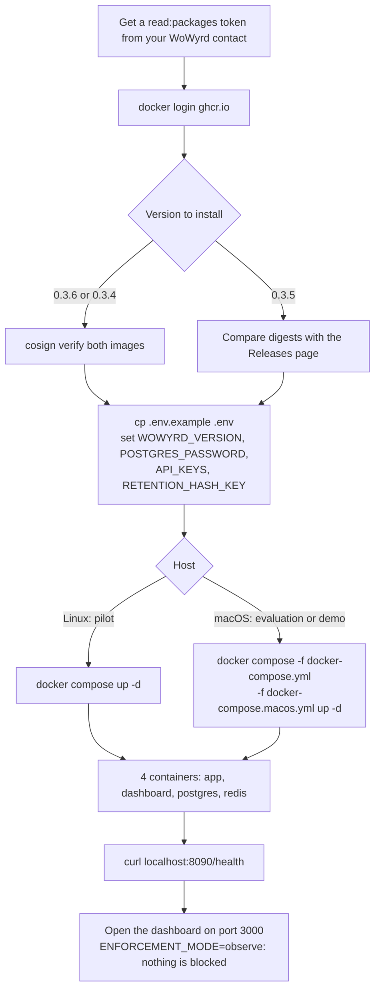
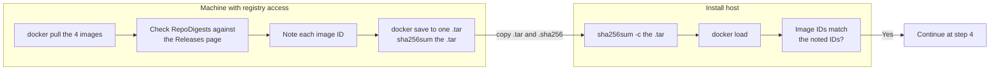
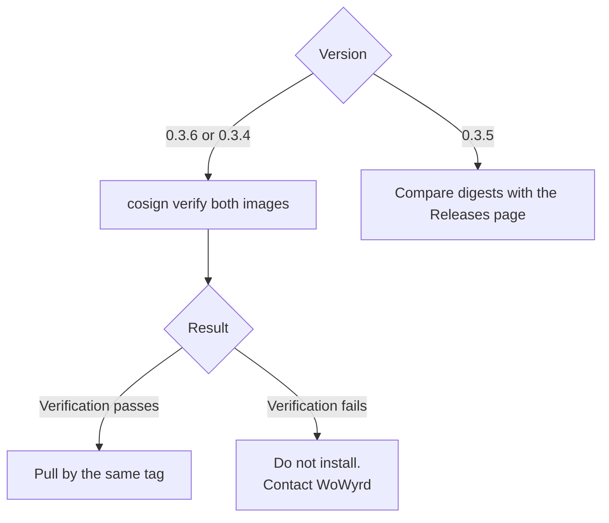

# WoWyrd — pilot install runbook

The authoritative, step-by-step install procedure for a PILOT-tier evaluation: shadow-mode only,
Full profile (PostgreSQL + Redis), no Kubernetes, no air-gapped delivery, no kernel-enforcement
packaging. `README.md` stays the general overview; this file is the one source of truth for "what
do I actually run" — update this file when the install procedure changes. Upgrade, backup,
rollback and uninstall are in [`OPERATIONS.md`](OPERATIONS.md).
[wowyrd.net/install/](https://wowyrd.net/install/) gives a short summary of these steps and
defers to this file. This file is the source of truth.

## Which profile to use

| | Full (PostgreSQL + Redis) | Lite (embedded SQLite) |
|---|---|---|
| Use it for | A pilot on your own data | A quick look only |
| Containers | 4: `wowyrd-app`, `wowyrd-dashboard`, `wowyrd-postgres`, `wowyrd-redis` | 2: `wowyrd-app`, `wowyrd-dashboard` |
| Transaction evaluation, case queue | Yes | Yes |
| Rule pack loaded | 47 rules in `v0.3.6` (2 of them cannot fire yet, see `CHANGELOG.md`), 41 in `v0.3.5`, 38 in `v0.3.4` | Same as Full |
| Detection | All loaded rules can fire | Not the same as Full (see below) |
| Retro-analysis report page | Yes | Yes from `v0.3.6`. Not available in `v0.3.5` |
| Evidence report (`/v1/reports/evidence`) | Yes | Not available |
| Champion-challenger comparison | Yes | Not available |
| Manager KPIs, Author tab | Yes | Not available |
| Fraud feedback (`/v1/feedback`), confirmed-fraud import, payment callback | Yes | Yes from `v0.3.6`. Not available in `v0.3.5` |
| Step-up, webhooks, action gates, score-threshold changes | Yes | Not available |
| Personal data anonymization after the retention period | Yes, with `RETENTION_HASH_KEY` set (step 4) | Not available: Lite keeps all personal data |

A pilot uses the Full profile, because on Lite detection is not the same as Full and the
champion-challenger comparison is not available. Steps 1–6 below install it.
The Lite profile returns a "not available in the embedded lite profile" error for every feature
marked "Not available". Rules that need dormancy or threat-indicator history (e.g. dormant-account
wake, known-bad indicator) may not fire on Lite, so detection is not the same as Full, even though
the same rule pack is loaded. Step 7 covers the Lite profile.

## Install flow



The diagram shows steps 1–5. Step 7 (Lite) is a separate quick look, not a pilot.

## 1. Prerequisites

- Docker + Docker Compose.
- A Linux host for a pilot. The Full profile runs `wowyrd-app` with host networking and
  privileged mode, for optional eBPF enforcement. eBPF is optional: without it (on a kernel older
  than 5.15, or with `NETWORK_INTERFACE` unset) WoWyrd runs in PostgreSQL-only mode.
- macOS is for evaluation or a demo only — see "macOS / Docker Desktop" at the end of step 4.
  Use the macOS overlay to evaluate WoWyrd on a Mac. Run a pilot on your own data on a Linux
  server.
- A GitHub Personal Access Token scoped to `read:packages` (your WoWyrd engineering contact
  issues this on request) — both images are private.
- `WOWYRD_VERSION` **0.3.4 or later.** `v0.3.4` is the first version published on this repo's
  Releases page. Earlier versions are not published here, and they are unsigned.

## 2. Authenticate to the image registry (one-time per machine)

```bash
echo "$WOWYRD_PAT" | docker login ghcr.io -u wowyrd --password-stdin
```

The registry checks the token only. The user name can be any value, and you don't need a GitHub
account of your own.

### Option B: a host without registry access

If the install host cannot reach `ghcr.io`, copy the images to it as one file.



On a machine with registry access (log in as above first, and do step 3 there):

1. Pull the four images:
   ```bash
   V=0.3.6
   docker pull ghcr.io/chavychaze/wowyrd-app:$V
   docker pull ghcr.io/chavychaze/wowyrd-dashboard:$V
   docker pull postgres:15-alpine
   docker pull redis:7-alpine
   ```
2. Show the digest and the ID of each WoWyrd image:
   ```bash
   for i in wowyrd-app wowyrd-dashboard; do
     docker image inspect ghcr.io/chavychaze/$i:$V --format '{{index .RepoDigests 0}}  {{.Id}}'
   done
   ```
   The digest must match the digest on the version's Releases page entry. Note each image ID.
3. Save the images to one file and make its checksum:
   ```bash
   docker save -o wowyrd-$V.tar ghcr.io/chavychaze/wowyrd-app:$V \
     ghcr.io/chavychaze/wowyrd-dashboard:$V postgres:15-alpine redis:7-alpine
   sha256sum wowyrd-$V.tar > wowyrd-$V.tar.sha256    # macOS: shasum -a 256
   ```
4. Copy `wowyrd-$V.tar` and `wowyrd-$V.tar.sha256` to the install host.

On the install host:

1. Check the file and load it:
   ```bash
   sha256sum -c wowyrd-$V.tar.sha256
   docker load -i wowyrd-$V.tar
   ```
2. Show the image IDs:
   ```bash
   docker image inspect ghcr.io/chavychaze/wowyrd-app:$V ghcr.io/chavychaze/wowyrd-dashboard:$V --format '{{.Id}}'
   ```
   Each ID must match the ID that you noted. After `docker load`, `RepoDigests` is empty. That is
   normal: `docker save` writes a new manifest, so the Releases page digest cannot be checked on
   this host. The image ID is the check here.
3. Continue at step 4. Compose uses the loaded images and does not try to pull them.

The `0.3.6` and `0.3.5` images are built for `linux/amd64` only. From `v0.3.6`, the Compose files
ask for `linux/amd64`, so an arm64 host (for example a Mac with Apple silicon) runs the images
under emulation.

## 3. Verify the images are genuinely signed by WoWyrd (recommended before first pull)



`v0.3.6` and `v0.3.4` are signed with [cosign](https://docs.sigstore.dev/cosign/signing/overview/). The
signature comes from the WoWyrd release workflow on GitHub Actions (keyless signing, with
Sigstore's public Fulcio and Rekor services). No signing key is stored, so no key can leak.

**`v0.3.5` is not signed.** Its images were built and pushed manually while the signed release
pipeline was unavailable. `cosign verify` fails against `0.3.5`, and that failure says nothing
about the images' integrity either way. Compare the image digests on the `v0.3.5` Releases page
entry instead. Releases before `v0.3.4` are unsigned too.

1. Install cosign ([instructions](https://docs.sigstore.dev/cosign/system_config/installation/)).
2. Verify both images. Set `V` to the version that you install:
   ```bash
   V=0.3.6
   for IMAGE in wowyrd-app wowyrd-dashboard; do
     cosign verify \
       --certificate-identity-regexp "^https://github.com/chavychaze/.*$" \
       --certificate-oidc-issuer "https://token.actions.githubusercontent.com" \
       ghcr.io/chavychaze/$IMAGE:$V
   done
   ```
3. Each command must succeed and print `The cosign claims were validated`. If a command fails, do
   not install. Contact WoWyrd.
4. Compare the `docker-manifest-digest` value in the output with the digest on the Releases page
   entry for that version.

A Software Bill of Materials (CycloneDX format) for each image — `wowyrd-app.cdx.json` and
`bom.json` respectively — is attached to each release on this repo's Releases page for a
vendor-security review.

## 4. Configure and start (Full profile)

```bash
cp .env.example .env
# edit .env: set WOWYRD_VERSION=0.3.6 (drop the leading "v" — see README.md's
# "Versions" section), POSTGRES_PASSWORD, API_KEYS, DASHBOARD_API_KEYS (see "Limit who can open
# the dashboard and the API" below) and RETENTION_HASH_KEY (see "Personal data anonymization").
# On an internet-facing host, also add POSTGRES_BIND=127.0.0.1 and REDIS_BIND=127.0.0.1, so the
# database and cache ports are not exposed (both default to 0.0.0.0).

docker compose up -d
```

This starts 4 containers. Confirm that directly:

```bash
docker compose ps   # expect wowyrd-app, wowyrd-dashboard, wowyrd-postgres, wowyrd-redis
```

### Limit who can open the dashboard and the API (set it before you send real data)

The dashboard web page contains the value of `DASHBOARD_API_KEYS`. Anyone who can open the page
can read the key. The app accepts this key only for reads, but the reads include your cases and
their personal data. Changes (block, unblock, reviews) need an operator key. This applies to the
Full and Lite profiles.

By default, the dashboard (port 3000) and `wowyrd-app` (port 8090) accept connections on all
network interfaces. Do these steps:

1. Set `DASHBOARD_API_KEYS` to a new value. Never use a value from `API_KEYS`.
2. Allow ports 3000 and 8090 only from your analysts' network and from your integration servers.
   Use the host firewall or a VPN. In the Full profile, `wowyrd-app` uses the host network, so
   the firewall is the only way to limit port 8090.
3. Do not open ports 3000 and 8090 to the internet.

### Create your operators

An operator key lets one person make changes: block, unblock, review a case or a rule, and
approve rule-weight changes and action gates. The dashboard asks for this key when a person makes
a change. A new install has no active operator. Until you create one, the app logs this warning
at start: "no active operator exists -- calibration, action-gates, manual block/unblock, and
case/soundness review are all unusable until one is provisioned".

1. Create one operator for each person. The command prints the key one time only:
   ```bash
   docker compose exec wowyrd-app operator_tool create --name <name>
   ```
   By default, one operator can propose and approve their own rule-weight change. For dual
   control, set `REQUIRED_APPROVALS_DEFAULT=2`. Then a proposal needs the approval of a
   different operator.
2. Give the key to that person in a secure way. The app stores only a hash of the key.
3. To see the operators, run `docker compose exec wowyrd-app operator_tool list`.
4. To turn off a key, run `docker compose exec wowyrd-app operator_tool deactivate --id <id>`.
   To replace a key, turn off the old one and create a new one.

On the Lite profile, use `docker compose -f docker-compose.yml -f docker-compose.lite.yml exec`
in place of `docker compose exec`.

### Personal data anonymization (set it before you send real data)

The Full profile anonymizes stored personal data (IP address, device, session, customer ID and
blocked values) when it is older than `RETENTION_ANONYMIZE_AFTER_DAYS` (default 180 days; blocked
values after 365 days). It does this only when `RETENTION_HASH_KEY` is set. In `.env.example`,
`RETENTION_HASH_KEY` is empty.

Without the key, the app keeps all personal data. It does not stop and does not show an error.
Once a day, it logs "RETENTION_HASH_KEY not set — retention anonymization pass skipped entirely".
From `v0.3.6`, `GET /health` shows it too: `retention.active` is `false`, and
`retention.inactive_reason` says why. From `v0.3.6`, the pass also anonymizes imported
champion-challenger data.

To turn anonymization on:

1. Make a key: `openssl rand -hex 32`.
2. Set `RETENTION_HASH_KEY` in `.env` to this key. Keep a copy in your secrets store.
3. Do not change the key later. After a change, customer IDs anonymized with the old key do not
   match new ones.
4. Restart `wowyrd-app` with the same `docker compose ... up -d` command that you used to start it.
5. From `v0.3.6`: `curl http://localhost:8090/health` must show `"retention"` with `"active": true`.

The Lite profile does not anonymize personal data. It keeps all of it, with or without the key.

### Optional: the datacenter ASN list

The `datacenter_asn` rule uses only the `client_asn` field (a number) that you send with each
transaction to `POST /v1/evaluate`. It fires when that ASN is on the datacenter ASN list. The
`datacenter_ip` rule does not use this list.

From `v0.3.6`, the app contains a default list of 24 cloud and hosting ASNs. `GET /health` shows
which list the app uses: `datacenter_asn.source` is `bundled` or `operator`, and
`datacenter_asn.count` is the number of ASNs.

To use your own list:

1. Create `config/intel/datacenter-asns.txt`.
2. Write one ASN per line, as a number (for example `16509`). The app ignores blank lines and
   lines that start with `#`.
3. Restart `wowyrd-app`. The app reads the list only at start.

If this file exists, the app uses only this file, not the default list. To turn the rule off, make
the file empty: `GET /health` then shows `operator` and `0`.

In `v0.3.5`, no image contains a list. Without your file, the rule is off, and the app logs
"datacenter ASN list not loaded — datacenter_asn disabled" at start.

### macOS / Docker Desktop (evaluation or demo only)

On Docker Desktop, the Full profile's host networking leaves `wowyrd-app`'s port 8090 unreachable
from the Mac itself, so the dashboard cannot reach the API. To run the Full profile on a Mac for
an evaluation or a demo, add the `docker-compose.macos.yml` overlay:

```bash
docker compose -f docker-compose.yml -f docker-compose.macos.yml up -d
```

The overlay moves `wowyrd-app` onto Compose's normal network and turns eBPF off. WoWyrd then runs
in PostgreSQL-only mode, with the same 4 containers and the same features as the Full profile on
Linux, except optional eBPF enforcement. Use the macOS overlay to evaluate WoWyrd on a Mac. Run a
pilot on your own data on a Linux server. The Lite profile (step 7) also runs on macOS.

## 5. Confirm shadow mode is running

```bash
curl http://localhost:8090/health
```

Open the dashboard at `http://localhost:3000` (or `http://<HOST_IP>:3000` if you set `HOST_IP` in
`.env`) and confirm it loads — shadow-mode evidence data will populate as real/synthetic traffic
is evaluated. `ENFORCEMENT_MODE` defaults to `observe` — nothing is ever blocked automatically.

## 6. If something doesn't work

Reach out to your WoWyrd engineering contact — this is a guided technical pilot, not a self-serve
product. If you're timing this install for the first time, please record: total wall-clock time,
and every step above that needed something not written down here, exactly as written — that
feedback is what keeps this runbook honest.

## 7. Quick look without a database (Lite profile — not for a pilot)

The Lite profile is for a quick look. Its detection is not the same as Full, and it leaves out
the features marked "Not available" in "Which profile to use" above. So it is not a pilot profile.

```bash
cp .env.example .env
# edit .env: set WOWYRD_VERSION=0.3.6, API_KEYS, DASHBOARD_API_KEYS, and POSTGRES_PASSWORD to any placeholder value
# (this profile never connects to Postgres, but Compose still validates the variable exists —
# see docker-compose.lite.yml's own comment on why).

docker compose -f docker-compose.yml -f docker-compose.lite.yml up -d wowyrd-app wowyrd-dashboard
```

This starts exactly 2 containers (`wowyrd-app`, `wowyrd-dashboard`) — no Postgres, no Redis, no
privileged/host-networking/eBPF configuration of any kind, on any Linux, macOS, or kernel version.
Confirm that directly if you want to:

```bash
docker compose -f docker-compose.yml -f docker-compose.lite.yml config --services
docker ps   # expect exactly wowyrd-app + wowyrd-dashboard
```

The dashboard page contains `DASHBOARD_API_KEYS` here too. Do the steps in step 4, "Limit who can open
the dashboard and the API". In Lite, `WOWYRD_APP_PORT` sets the app port.

---

**Status note (2026-10-16): the under-30-minute install by someone who didn't write this runbook
has not been timed for real yet.** An actual timed run on a clean VM, by someone else, is still
outstanding — treat any timing claim as unverified until it has.
