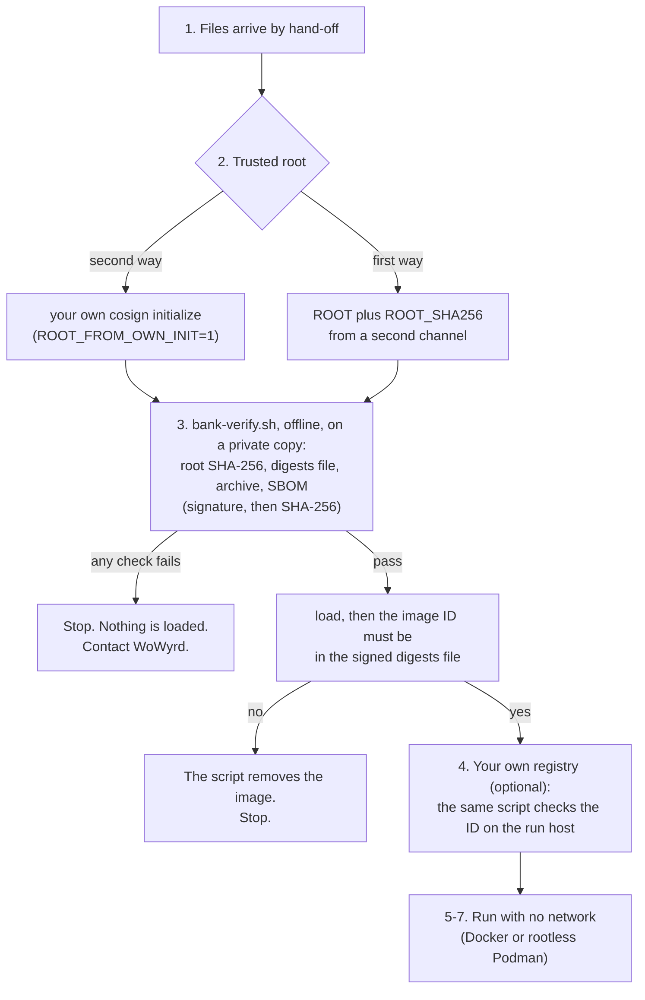
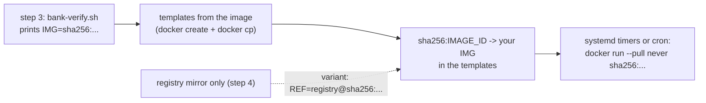
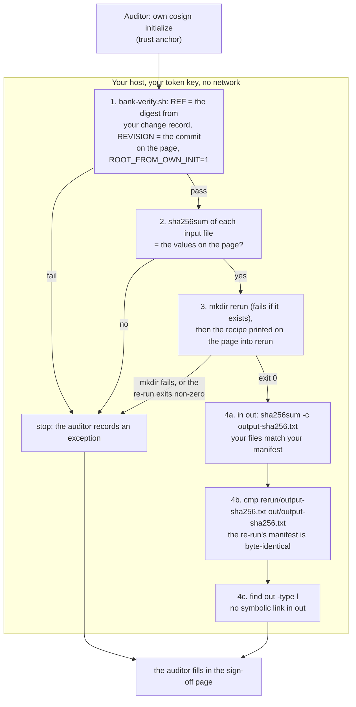

# Rule review only: install and run

The rule review runs alone, inside your network, on your own files. You install one container image. It holds the
rule review and Python, and nothing else: no engine, no sensor, no database. It runs with no network, a read-only
file system and a non-root user. Your files and your reports stay on your host.

You get the image as a signed file, not from a public registry. You check the signature before you load anything.
Every check in this guide works with no internet on the host.

> **Licence.** `LicenseRef-WoWyrd-Proprietary`. The image carries the same text in `/licenses/LICENSE` and the name
> in its `org.opencontainers.image.licenses` label (step 3 shows how to read both). Your signed agreement with
> WoWyrd holds the full terms.
>
> Proprietary software of WoWyrd. Licensed for internal use by the customer and by its affiliates (branches and subsidiaries, in any country) named in the signed agreement with WoWyrd, for their own operations, while the subscription is active. No transfer to other parties, resale or modification. All rights reserved.
>
> Власницька програма WoWyrd. Використання дозволено клієнту та його філіям і дочірнім компаніям у будь-якій країні, якщо їх названо в підписаному договорі з WoWyrd. Лише для власних потреб і поки діє підписка. Передавати іншим особам, перепродавати чи змінювати заборонено. Усі права захищено.



The diagram reads top to bottom. You choose the trusted root first. One script then copies the files into a private
folder. It checks the trusted root, three signatures and two SHA-256 values before the load. After the load, it checks the image ID. On a run host, the same script checks the ID
again. Only then do you run the review.

## What you receive

`V` is the release version, for example `V=0.6.0`. `ARCH` is your platform: `amd64` for `x86_64` hosts, `arm64` for
`aarch64` hosts (`uname -m` tells you).

| File | What it is |
|---|---|
| `wowyrd-rule-review-v$V-amd64.tar.gz`, `wowyrd-rule-review-v$V-arm64.tar.gz` | The image, one archive per platform |
| `wowyrd-rule-review-v$V-<arch>.tar.gz.sigstore.json` | The signature of each archive |
| `wowyrd-rule-review-digests-v$V.txt` | Per platform: the archive name and SHA-256, the SBOM SHA-256, the image ID, the registry digest |
| `wowyrd-rule-review-digests-v$V.txt.sigstore.json` | The signature of the digests file |
| `wowyrd-rule-review-<arch>.cdx.json` and its `.sigstore.json` | The software bill of materials (CycloneDX) and its signature |
| `wowyrd-rule-review-v$V-sigstore-trusted-root.json` | A copy of the Sigstore trusted root. Use it only with `ROOT_SHA256` (step 2) |
| `reference-bundle-v$V.json` and its `.sigstore.json` | The monthly update of our reference set (optional, step 7) |

The hand-off message gives the SHA-256 of the trusted root copy. We send that message apart from the files. The
release-notes file in the same folder also shows the value, but it is not a second channel: it travels with the
files, so a changed hand-off could change it too.

## Tools you need

1. `cosign`. v0.7.0 or later: cosign 3.1.4 or newer; v0.6.0 and older: cosign 2.6.1.
   Our release job signs v0.7.0 and later with cosign 3.1.4.
   Tested 2026-11-18 (release dry run): files signed with cosign 3.1.4 verify with cosign 2.6.1 and 3.1.3; image
   signatures made with 3.1.4 verify with 3.1.3, and cosign 2.6.1 reports "no signatures found". Use 3.1.4 or newer.
   Files signed with cosign 2.6.1 also verify with cosign 2.6.1, 3.1.3 and 3.1.4. The check uses
   `verify-blob --new-bundle-format --offline`, with the same flags for every version. cosign 3 prints a
   deprecation warning for `--new-bundle-format` (and for `--offline`).
   The warning is harmless: the check still passes.
   Get cosign from a source your team already trusts, for example Sigstore's own release page and its published
   checksums.
2. Docker, or Podman. Rootless Podman with SELinux enforcing is tested on RHEL 9.9 (2026-11-18, v0.6.0), and on
   AlmaLinux 9.8 and 8.10 (step 6).
3. `bash`, `grep`, `mktemp` and `sha256sum`. On macOS, `shasum -a 256` does the same job. The script uses it when
   `sha256sum` is missing.

## 1. Set the version and your platform

```sh
V=0.6.0          # the release you received
ARCH=amd64       # or arm64
```

The script of step 3 checks every signature against one exact signer:
`https://github.com/chavychaze/wowyrd-lts/.github/workflows/release.yml@refs/tags/v$V`, with the issuer
`https://token.actions.githubusercontent.com`. That is our release workflow, for exactly this tag. A test build,
another workflow or another tag does not match it. An older signed release does not match it either. So nobody can
hand you an older release in place of this one.

## 2. Get a trusted root you trust

The trusted root holds Sigstore's public keys. cosign needs it to check a signature with no network. The root is the
anchor of every check in this guide. The script of step 3 stops until you choose one of the two ways below.

**First way: `ROOT` plus `ROOT_SHA256`.** Give the root file and its SHA-256 from a second channel:

1. Get the SHA-256 of the trusted root from the hand-off message. A host with no internet: call WoWyrd and write the
   value down as we read it to you.
2. Do not take the value from the release-notes file in the hand-off folder. That file is not a second channel.
3. In step 3, set `ROOT="wowyrd-rule-review-v$V-sigstore-trusted-root.json"` and `ROOT_SHA256=<the value>`. The
   script hashes the file and stops if the values differ. The copy travels with the files it checks, so without
   `ROOT_SHA256` it proves nothing.
4. If you cannot get the value over a second channel, do not use the copy. Use the second way, or stop and contact
   WoWyrd.

**Second way: your own `cosign initialize`.** The file must come from your own `cosign initialize`. The script
checks its location and that it is not the shipped copy. It cannot prove where the file came from.

1. On a machine with internet, run `cosign initialize`. Use the cosign from "Tools you need". It fetches the root from
   Sigstore's own repository and checks it.
2. cosign writes the file to `~/.sigstore/root/tuf-repo-cdn.sigstore.dev/targets/trusted_root.json` (we checked
   cosign 2.6.1 on Linux and cosign 3.1.3 on macOS: the same path). On the host, keep the file at that path, or set
   `ROOT` to where you put it. The file must be outside the hand-off folder.
3. In step 3, set `ROOT_FROM_OWN_INIT=1`. Without `ROOT`, the script reads the path of item 2 under your `HOME`.
4. The script stops if `ROOT` is inside the hand-off folder, is a symbolic link, or has a shipped copy's file name.
   It also stops if the file has the same bytes as a `wowyrd-rule-review-v*-sigstore-trusted-root.json` file in the
   hand-off folder. Your own root can have the same bytes as our copy, because both come from the same Sigstore
   source. Then use the first way.

## 3. Verify, then load

Save the block below as `bank-verify.sh` in the folder with the files. Then run it with `bash`:

```sh
V=0.6.0 ARCH=amd64 ROOT="wowyrd-rule-review-v0.6.0-sigstore-trusted-root.json" \
  ROOT_SHA256=<value from the hand-off message> bash bank-verify.sh          # Docker, first way
V=0.6.0 ARCH=amd64 ENGINE=podman ROOT="wowyrd-rule-review-v0.6.0-sigstore-trusted-root.json" \
  ROOT_SHA256=<value from the hand-off message> bash bank-verify.sh          # Podman, first way
V=0.6.0 ARCH=amd64 ROOT_FROM_OWN_INIT=1 bash bank-verify.sh                  # second way: your own cosign initialize
```

Do not paste the block into an open terminal. The script ends with exit 1 at the first failed check, and that would
close the terminal. Optional settings:

| Setting | Default | What it does |
|---|---|---|
| `ROOT` | first way: `wowyrd-rule-review-v$V-sigstore-trusted-root.json`; second way: `$HOME/.sigstore/root/tuf-repo-cdn.sigstore.dev/targets/trusted_root.json` | The trusted root file |
| `ROOT_SHA256` | none | The root's SHA-256 from a second channel. The script stops on a mismatch |
| `ROOT_FROM_OWN_INIT` | none | `1` when `ROOT` came from your own `cosign initialize` (step 2, second way) |
| `REVISION` | none | The full commit named in the hand-off message, 40 hex characters. It must equal the signed `revision:` line. On a match, the script prints `Revision: the signed digests file names commit ...` |
| `ENGINE` | `docker` | `docker` or `podman` |
| `COSIGN` | `cosign` | The cosign binary |
| `TMPDIR` | `/tmp` | Where the private copy goes. It needs room for one archive |

The script first copies every file it checks into a new private folder (mode 0700). It checks, hashes and loads only
that copy, and removes the folder at the end. A file that changes in the hand-off folder during the run changes
nothing.

Every signature must come from our private release repository, `chavychaze/wowyrd-lts` (step 1). The image label
`org.opencontainers.image.source` names our public repository, `chavychaze/wowyrd-pub`, on purpose: that is where this
guide lives. The signer identity is the authority, not the label.

<!-- bank-verify.sh: BEGIN -->
```sh
set -euo pipefail
: "${V:?set V to the release version, for example V=0.6.0}"
: "${ARCH:?set ARCH to amd64 or arm64}"
ENGINE="${ENGINE:-docker}"
ROOT="${ROOT:-}"
ROOT_SHA256="${ROOT_SHA256:-}"
ROOT_FROM_OWN_INIT="${ROOT_FROM_OWN_INIT:-}"
COSIGN="${COSIGN:-cosign}"
REF="${REF:-}"
REVISION="${REVISION:-}"
IDENTITY="https://github.com/chavychaze/wowyrd-lts/.github/workflows/release.yml@refs/tags/v$V"
ISSUER="https://token.actions.githubusercontent.com"
DIGESTS="wowyrd-rule-review-digests-v$V.txt"
ARCHIVE="wowyrd-rule-review-v$V-$ARCH.tar.gz"
SBOM="wowyrd-rule-review-$ARCH.cdx.json"

stop() { echo "STOP: $*. Do not load or run the image. Keep the files and contact WoWyrd." >&2; exit 1; }
sha256() { if command -v sha256sum >/dev/null 2>&1; then sha256sum "$1"; else shasum -a 256 "$1"; fi | cut -d' ' -f1; }
# The signed digests file is read once, from the private copy, into SIGNED. Every check matches a whole line of it.
SIGNED=""
listed() { grep -Fxq -- "$1" <<< "$SIGNED"; }
sum_listed() { local sum; sum="$(sha256 "$W/$2")" || return 1; [ -n "$sum" ] && listed "linux/$ARCH $1: $sum"; }
verify() {
  "$COSIGN" verify-blob --new-bundle-format --offline --trusted-root "$W/root.json" \
    --bundle "$W/$1.sigstore.json" \
    --certificate-identity "$IDENTITY" --certificate-oidc-issuer "$ISSUER" "$W/$1"
}
# Docker prints the ID as sha256:<hex>. Podman prints <hex> alone.
image_id() {
  local id
  id="$("$ENGINE" image inspect --format '{{.Id}}' -- "$1" 2>/dev/null)" || id=""
  if [ -n "$id" ]; then echo "sha256:${id#sha256:}"; fi
}
# What the load says it loaded. Docker and Podman: "Loaded image: <name>". Docker, an untagged image: "Loaded image ID:
# sha256:<hex>". Older Podman: "Loaded image(s): <name>,<name>". Podman names a docker save archive
# docker.io/library/<name>, so the script reads the name from the load and never guesses one.
loaded_refs() {
  printf '%s\n' "$1" | sed -n -e 's/^Loaded image ID: //p' -e 's/^Loaded image(s): //p' -e 's/^Loaded image: //p' \
    | tr ',' '\n' | tr -d ' \r'
}
id_listed() {
  [[ "$1" =~ ^sha256:[0-9a-f]{64}$ ]] || return 1
  listed "linux/$ARCH image_id: $1" || listed "linux/$ARCH digest: $1"
}
# copy NAME FILE: copy FILE into the private folder as NAME, or stop if FILE is missing or the copy fails.
copy() {
  [ -f "$2" ] || stop "$2 is missing"
  cp -- "$2" "$W/$1" || stop "cannot copy $2 into the private folder under ${TMPDIR:-/tmp}. Is it full"
}

# 0. The inputs, before any file is read.
[[ "$V" =~ ^[0-9]+\.[0-9]+\.[0-9]+$ ]] || stop "V must be a release version such as 0.6.0, not '$V'"
case "$ARCH" in amd64|arm64) ;; *) stop "ARCH must be amd64 or arm64, not '$ARCH'" ;; esac
case "$ENGINE" in docker|podman) ;; *) stop "ENGINE must be docker or podman, not '$ENGINE'" ;; esac
# A digest is lowercase hex (OCI image spec), so an uppercase digest is refused. The name must not start with "-".
if [ -n "$REF" ] && [[ ! "$REF" =~ ^[^-@[:space:]][^@[:space:]]*@sha256:[0-9a-f]{64}$ ]]; then
  stop "REF must be a reference by digest, <registry path>@sha256:<64 lowercase hex>, not '$REF'"
fi
REVISION="$(printf '%s' "$REVISION" | tr 'A-F' 'a-f')"
if [ -n "$REVISION" ] && [[ ! "$REVISION" =~ ^[0-9a-f]{40}$ ]]; then
  stop "REVISION must be the full commit, 40 hex characters, not '$REVISION'"
fi
ROOT_SHA256="$(printf '%s' "$ROOT_SHA256" | tr 'A-F' 'a-f')"
case "$ROOT_FROM_OWN_INIT" in
  "") [ -n "$ROOT_SHA256" ] || stop "set ROOT_SHA256 to the trusted root's SHA-256 from the hand-off message or a call to WoWyrd, or set ROOT_FROM_OWN_INIT=1 if ROOT came from your own cosign initialize"
      ROOT="${ROOT:-wowyrd-rule-review-v$V-sigstore-trusted-root.json}" ;;
  1) if [ -z "$ROOT" ]; then
       [ -n "${HOME:-}" ] || stop "ROOT_FROM_OWN_INIT=1 needs HOME, or set ROOT to the file your own cosign initialize wrote"
       ROOT="$HOME/.sigstore/root/tuf-repo-cdn.sigstore.dev/targets/trusted_root.json"
     fi
     case "${ROOT##*/}" in
       wowyrd-rule-review-v*-sigstore-trusted-root.json) stop "ROOT_FROM_OWN_INIT=1, but $ROOT is the shipped copy. Set ROOT_SHA256 for it instead" ;;
     esac
     # Your own root never comes from the hand-off folder: not from a file in it, not through a link into it.
     [ -f "$ROOT" ] || stop "$ROOT is missing"
     [ ! -L "$ROOT" ] || stop "ROOT_FROM_OWN_INIT=1, but $ROOT is a symbolic link. Give the file itself"
     HERE="$(pwd -P)"
     ROOT_DIR="$(cd -- "$(dirname -- "$ROOT")" && pwd -P)" || stop "cannot open the folder of $ROOT"
     case "$ROOT_DIR/" in
       "$HERE"/*) stop "ROOT_FROM_OWN_INIT=1, but $ROOT is inside the hand-off folder. Use the file your own cosign initialize wrote, or set ROOT_SHA256 for the shipped copy" ;;
     esac ;;
  *) stop "ROOT_FROM_OWN_INIT must be 1 or unset, not '$ROOT_FROM_OWN_INIT'" ;;
esac
if [ -n "$ROOT_SHA256" ] && [[ ! "$ROOT_SHA256" =~ ^[0-9a-f]{64}$ ]]; then
  stop "ROOT_SHA256 must be 64 hex characters, not '$ROOT_SHA256'"
fi

# 1. A private copy of every file the checks read: a new folder, mode 0700, removed when the script ends.
W="$(mktemp -d "${TMPDIR:-/tmp}/bank-verify.XXXXXX")" || stop "cannot make a private folder under ${TMPDIR:-/tmp}. Is it full or not writable"
trap 'rm -rf "$W"' EXIT
trap 'exit 1' HUP INT TERM
# The folder must be a real folder that you own, not a link to a place someone else controls.
if [ ! -d "$W" ] || [ -L "$W" ] || [ ! -O "$W" ]; then stop "the private folder '$W' is not a folder of your own"; fi
chmod 0700 "$W" || stop "cannot set mode 0700 on the private folder $W"
copy root.json "$ROOT"
copy "$DIGESTS" "$DIGESTS"
copy "$DIGESTS.sigstore.json" "$DIGESTS.sigstore.json"
if [ -z "$REF" ]; then
  for f in "$ARCHIVE" "$ARCHIVE.sigstore.json" "$SBOM" "$SBOM.sigstore.json"; do copy "$f" "$f"; done
fi

# 2. The trusted root's SHA-256. Then the digests file: its signature, its version, its revision.
ROOT_SUM="$(sha256 "$W/root.json")"
echo "Trusted root $ROOT: SHA-256 $ROOT_SUM"
if [ -n "$ROOT_SHA256" ] && [ "$ROOT_SUM" != "$ROOT_SHA256" ]; then
  stop "the SHA-256 of $ROOT is $ROOT_SUM, not the ROOT_SHA256 you set ($ROOT_SHA256)"
fi
if [ "$ROOT_FROM_OWN_INIT" = 1 ]; then
  for shipped in wowyrd-rule-review-v*-sigstore-trusted-root.json; do
    if [ -f "$shipped" ] && [ "$(sha256 "$shipped")" = "$ROOT_SUM" ]; then
      stop "ROOT_FROM_OWN_INIT=1, but $ROOT has the same bytes as the shipped copy $shipped. The script cannot tell your own root from that copy, so set ROOT_SHA256 to the value from the hand-off message instead"
    fi
  done
fi
verify "$DIGESTS" || stop "the digests file does not verify"
SIGNED="$(cat "$W/$DIGESTS")"
listed "version: $V" || stop "the digests file is not for version $V"
# The index digest from the checked copy, for a check by digest (a registry pull, or the x86 release check).
INDEX_LINE="$(grep -E '^index_digest: sha256:[0-9a-f]{64}$' <<< "$SIGNED" || true)"
case "$INDEX_LINE" in ""|*$'\n'*) ;; *) echo "Index digest: ${INDEX_LINE#index_digest: }" ;; esac
if [ -n "$REVISION" ]; then
  listed "revision: $REVISION" || stop "the digests file does not name revision $REVISION"
  echo "Revision: the signed digests file names commit $REVISION."
fi

# On a run host: check an image pulled from your own registry by digest. No archive, no load.
if [ -n "$REF" ]; then
  ID="$(image_id "$REF")"
  id_listed "$ID" || stop "the image ID of $REF ('${ID:-none}') is not in the signed digests file for linux/$ARCH"
  echo "OK: $REF has image ID $ID. The signed digests file lists it for linux/$ARCH."
  exit 0
fi

# 3. The archive and the SBOM: their signatures, then their SHA-256 values in the signed digests file.
verify "$ARCHIVE" || stop "the archive does not verify"
listed "linux/$ARCH archive: $ARCHIVE" || stop "the digests file does not name $ARCHIVE for linux/$ARCH"
sum_listed archive_sha256 "$ARCHIVE" || stop "the SHA-256 of $ARCHIVE is not the signed one"
verify "$SBOM" || stop "the SBOM does not verify"
sum_listed sbom_sha256 "$SBOM" || stop "the SHA-256 of $SBOM is not the signed one"

# 4. Load the private copy. The load must name what it loaded. Every name must have one image ID, and the signed
# digests file must list that ID for this platform. No name, no ID, or two IDs is a stop.
LOADED="$("$ENGINE" load -i "$W/$ARCHIVE" 2>&1)" || { printf '%s\n' "$LOADED" >&2; stop "the load failed"; }
printf '%s\n' "$LOADED"
REFS="$(loaded_refs "$LOADED")"
[ -n "$REFS" ] || stop "the load printed no image name, so the script cannot check what it loaded. Remove that image by hand"
ID=""
while IFS= read -r ref; do
  [ -n "$ref" ] || continue
  one="$(image_id "$ref")"
  if [ -z "$ID" ]; then ID="${one:-none}"; elif [ "$one" != "$ID" ]; then ID="more than one"; fi
done <<< "$REFS"
if ! id_listed "$ID"; then
  while IFS= read -r ref; do [ -z "$ref" ] || "$ENGINE" image rm -- "$ref" >/dev/null 2>&1 || true; done <<< "$REFS"
  stop "the loaded image ID ('${ID:-none}') is not in the signed digests file for linux/$ARCH. The image was removed"
fi
echo "OK: loaded as $(printf '%s' "$REFS" | tr '\n' ' ') with image ID $ID. The signed digests file lists it for linux/$ARCH."
echo "Run it by this ID: IMG=$ID"
```
<!-- bank-verify.sh: END -->

The script does these checks, in this order. It stops at the first failure:

1. The settings: `V` must be `X.Y.Z`, `ARCH` and `ENGINE` known values, `REF` a reference by digest in lowercase
   hex, `REVISION` a full 40-character commit, and one trusted root choice from step 2. With `ROOT_FROM_OWN_INIT=1`,
   `ROOT` must be outside the hand-off folder and not a symbolic link.
2. The private copy of every file. A missing file is a stop.
3. The trusted root: the script prints its SHA-256. With `ROOT_SHA256`, the two values must be equal. With
   `ROOT_FROM_OWN_INIT=1`, the value must differ from every shipped copy in the hand-off folder.
4. The digests file: its signature (offline, the exact signer), then its version. The script prints the signed
   index digest (`Index digest: sha256:...`); a pull by digest uses this value. With `REVISION`, its revision too.
5. The archive for your platform: its signature, its name, and its SHA-256 in the signed digests file.
6. The SBOM for your platform: its signature, and its SHA-256 in the signed digests file.
7. Only now: `docker load` or `podman load`, of the private copy.
8. The script takes the image name from the load's own output (`Loaded image: <name>`). Podman names a `docker
   save` archive `docker.io/library/wowyrd-rule-review:$V`. If the load prints no name, the script stops and never
   guesses one. Then remove the loaded image by hand (`docker images`, `podman images`). Every name the load prints
   must have the same image ID. The loaded image ID must be a whole line of the signed digests file for your
   platform. Docker's classic image store and Podman show the `image_id` value. Docker's containerd image store
   shows the `digest` value. If the ID is not there, the script removes the image and stops.

At the end it prints `IMG=sha256:...`. Run the review by this image ID.

**Read the licence from the image (optional).** The first line prints the licence name from the image label. The
second line copies `/licenses/LICENSE` out of the image into the current folder. It creates a container but never
starts it, and then removes it. With Podman, write `podman` for `docker`.

```sh
docker image inspect -f '{{ index .Config.Labels "org.opencontainers.image.licenses" }}' "$IMG"
CID="$(docker create "$IMG")" && docker cp "$CID:/licenses/LICENSE" ./wowyrd-rule-review-LICENSE; docker rm "$CID"
```

> **Tested with Podman.** Tested on RHEL 9.9 (2026-11-18, v0.6.0) with Podman 5.8.5. Earlier, on 2026-11-16:
> AlmaLinux 9.8 with Podman 5.8.2 and AlmaLinux 8.10 with Podman 4.9.4 (`4.9.4-rhel`), rebuilds of RHEL 9 and
> RHEL 8. RHEL 8 itself was not tested. Each run used
> a fresh VM, an unprivileged user, rootless Podman, and SELinux in enforcing mode. The archive was a `docker save`
> archive, compressed with `gzip -n -9`, the same way the release job makes it. Results, the same on both:
>
> 1. `podman load` reads the `.tar.gz` file as shipped. You do not unpack it first.
> 2. Podman names the image `docker.io/library/wowyrd-rule-review:$V`. It prints
>    `Loaded image: docker.io/library/wowyrd-rule-review:$V`. The script takes the name from this line.
> 3. Podman shows the same image ID as Docker. It is the `linux/amd64 image_id` line of the digests file.
> 4. A digests file with a wrong archive SHA-256: the script stopped before `podman load`. No image was loaded.
> 5. A digests file that lists this image ID for the other platform only: the script loaded the archive, refused
>    the ID, and removed the image.
>
> Do not run `localhost/wowyrd-rule-review:$V`. That name does not exist, so Podman tries to pull it from a registry
> (exit 125). Run by `IMG`. In this test, a test stand-in replaced cosign: it checked the arguments only. The
> release job checks the real signatures. The RHEL 9.9 run used the real release files and the real cosign 2.6.1: a
> changed archive stopped the script before the load. arm64 hosts were not tested.

## 4. Put it in your own registry (optional)

Keep the image in your registry, under your own change control. `REG` is your registry path, for example
`registry.example.internal/security/wowyrd-rule-review`.

Docker:

```sh
docker tag "$IMG" "$REG:$V"
docker push "$REG:$V"
docker image inspect --format '{{index .RepoDigests 0}}' "$REG:$V"   # note this reference: REF=$REG@sha256:...
```

Podman:

```sh
podman push --digestfile pushed-digest.txt "${IMG#sha256:}" "docker://$REG:$V"
REF="$REG@$(cat pushed-digest.txt)"
```

Both commands use `IMG`, the image ID that step 3 checked, not a name. A name can point to another image later.

Your registry may give the image a new registry digest. That is expected. On Docker's classic image store and on
Podman, the image ID does not change. On Docker's containerd image store, the image ID is the registry digest. There,
a push that changes the digest also changes the ID, and the script of step 3 stops on the run host. That stop is safe.
Run by the image ID on the host that loaded the archive, or use the classic store or Podman on the run host.

On each run host, pull by digest. Then run the same script with `REF`. `REF` must be a reference by digest
(`<registry path>@sha256:<64 hex>`); the script stops on a tag. It checks the digests file again, then the image ID of
`REF`. It needs only the digests file, its signature and the trusted root. It loads nothing:

```sh
docker pull "$REF"                                     # Podman: podman pull "$REF"
V=0.6.0 ARCH=amd64 REF="$REF" ROOT="wowyrd-rule-review-v0.6.0-sigstore-trusted-root.json" \
  ROOT_SHA256=<value from the hand-off message> bash bank-verify.sh   # Podman: add ENGINE=podman
V=0.6.0 ARCH=amd64 REF="$REF" ROOT_FROM_OWN_INIT=1 bash bank-verify.sh   # second way
```

Run by that digest (`IMG="$REF"`), or, on the host where you loaded the archive, by image ID (`IMG=sha256:...` from
step 3). Never run by a tag: a tag can move, a digest cannot. File the digest you run in your change record next to
the reports.

## 5. Prepare the folders

```sh
mkdir -p in out out.key previous
chmod 700 out.key
# Copy your own files into ./in: transactions.csv, decisions.csv, labels.csv, costs.json, ...
```

Get the input templates from the image itself. Docker:

```sh
mkdir -p in/templates
docker run --rm --network none --read-only --user "$(id -u):$(id -g)" --cap-drop ALL \
  --security-opt no-new-privileges --tmpfs /tmp:rw,noexec,nosuid,nodev,size=64m \
  -v "$PWD/in/templates:/work/in" "$IMG" --write-examples /work/in
```

Rootless Podman:

```sh
mkdir -p in/templates
podman run --rm --network none --read-only --userns=keep-id --user "$(id -u):$(id -g)" --cap-drop ALL \
  --security-opt no-new-privileges --tmpfs /tmp:rw,noexec,nosuid,nodev,size=64m \
  -v "$PWD/in/templates:/work/in:Z" "$IMG" --write-examples /work/in
```

This step has the same flags as step 6. It mounts only `in/templates` with write access, and it never overwrites a
file. Every other command mounts `in` read-only.

| Folder | Mount | What it holds |
|---|---|---|
| `in` | `/work/in`, read-only | Your input files |
| `previous` | `/work/previous`, read-only | The last period's output, for the follow-up |
| `out` | `/work/out` | Reports, summary, `report-state.json`, `token-map.csv` |
| `out.key` | `/work/out.key` | The token key. Keep it between runs; keep it out of anything you share |

## 6. Run the review

The first time, leave out the line `--previous /work/previous`. From the second period on, copy the last period's
`out` into `previous` and keep the line. (On a first run, with `previous` empty and no token key yet, the command as
written stops with exit 2: `--previous: the token key ... is missing`. Seen on RHEL 9.9, 2026-11-18.)

Docker:

```sh
docker run --rm \
  --network none \
  --read-only \
  --user "$(id -u):$(id -g)" \
  --cap-drop ALL \
  --security-opt no-new-privileges \
  --tmpfs /tmp:rw,noexec,nosuid,nodev,size=64m \
  -v "$PWD/in:/work/in:ro" \
  -v "$PWD/previous:/work/previous:ro" \
  -v "$PWD/out:/work/out" \
  -v "$PWD/out.key:/work/out.key" \
  "$IMG" \
  --demo-dir /work/in --label-delay-days 14 --period month --cutoff 2026-11-01 \
  --previous /work/previous --out /work/out
```

Rootless Podman on RHEL 8 or RHEL 9, SELinux enforcing:

```sh
podman run --rm \
  --network none \
  --read-only \
  --userns=keep-id \
  --user "$(id -u):$(id -g)" \
  --cap-drop ALL \
  --security-opt no-new-privileges \
  --tmpfs /tmp:rw,noexec,nosuid,nodev,size=64m \
  -v "$PWD/in:/work/in:ro,Z" \
  -v "$PWD/previous:/work/previous:ro,Z" \
  -v "$PWD/out:/work/out:Z" \
  -v "$PWD/out.key:/work/out.key:Z" \
  "$IMG" \
  --demo-dir /work/in --label-delay-days 14 --period month --cutoff 2026-11-01 \
  --previous /work/previous --out /work/out
```

> **Tested** with the command above, as written, run by `IMG` after the step 3 script (AlmaLinux 2026-11-16;
> RHEL 9.9 2026-11-18, v0.6.0):
>
> | OS | Kernel | Podman | Runtime, cgroup | SELinux |
> |---|---|---|---|---|
> | AlmaLinux 9.8 | `5.14.0-687.66.2.el9_8` | 5.8.2 | crun 1.27, cgroup v2 | enforcing, container-selinux 2.247.0 |
> | AlmaLinux 8.10 | `4.18.0-553.178.1.el8_10` | 4.9.4 (`4.9.4-rhel`) | runc 1.2.9, cgroup v1 | enforcing, container-selinux 2.229.0 |
> | RHEL 9.9 | `5.14.0-741.22.1.el9_9` | 5.8.5 | crun 1.29.1, cgroup v2 | enforcing, container-selinux 2.250.0 |
>
> On each, as an unprivileged user with rootless Podman:
>
> 1. Two runs, one month apart, the second with `--previous`: both exit 0.
> 2. Every output file and the token key belong to the host user.
> 3. The root file system is read-only. `/tmp` (the tmpfs) is writable.
> 4. SELinux logged no denial (`avc: denied`) for these runs.
> 5. Without `:Z`: exit 2, `error: /work/in/transactions.csv: Permission denied`. SELinux logs a denial: the
>    container (`container_t`) may not read a file in your home folder (`user_home_t`).
> 6. Without `--userns=keep-id`: exit 2, `/work/out.key/token-key: Permission denied`. The container user maps to a
>    sub-UID that cannot open your `out.key` folder (mode 700).
>
> On RHEL 9.9, items 1 to 3 were checked by the smoke script (the first month without `--previous`), plus: no
> network interface but `lo`, no DNS and no connection from inside the container, and the image refused UID 0
> (exit 2). Items 4 to 6 were checked on AlmaLinux only.

Why each flag:

1. `--network none`: the container has no network. The review sends nothing anywhere.
2. `--read-only`: the image's own files cannot change during a run. Only the mounts and `/tmp` are writable.
3. `--user "$(id -u):$(id -g)"`: the outputs belong to you. The image refuses to run as root (exit 2).
4. `--userns=keep-id` (rootless Podman only): your user ID is the same inside and outside the container. Without it,
   the outputs belong to a sub-UID that you cannot read.
5. `:Z` (Podman with SELinux only): labels each folder for this container, so SELinux lets the container read and
   write it. Use it only on these folders, never on a system folder or your home folder itself.
6. `--cap-drop ALL`, `--security-opt no-new-privileges`: no extra kernel rights.
7. `--tmpfs /tmp`: a small scratch space in memory. The reference bundle check needs it.

Options that call a language model are not part of this image. The run stops with exit 2 if one is given.

## 7. The monthly reference bundle (optional, offline)

Each release brings `reference-bundle-v$V.json` and its `.sigstore.json`: the monthly update of our reference set.
Put both files into `in`. The image checks the signature itself, with its own cosign and trusted root, and with no
network:

```sh
docker run --rm --network none --read-only --user "$(id -u):$(id -g)" --cap-drop ALL \
  --security-opt no-new-privileges --tmpfs /tmp:rw,noexec,nosuid,nodev,size=64m \
  -v "$PWD/in:/work/in:ro" "$IMG" --check-reference-bundle "/work/in/reference-bundle-v$V.json"
```

It must print `Reference bundle verified` and exit 0. Then add `--reference-bundle /work/in/reference-bundle-v$V.json`
to the run of step 6. (Podman: the same flags as step 6, with `:ro,Z` on the mount.)

If the check fails because the image's trusted root is older than the bundle's signature, pass your own root: copy
the trusted root from step 2 into `in` as `sigstore-trusted-root.json` and add
`--sigstore-trusted-root /work/in/sigstore-trusted-root.json`. The check never falls back to the network.

You can also check the bundle on the host with your own cosign. `ROOT` is the trusted root file from step 2:

```sh
cosign verify-blob --new-bundle-format --offline --trusted-root "$ROOT" \
  --bundle "reference-bundle-v$V.json.sigstore.json" \
  --certificate-identity "https://github.com/chavychaze/wowyrd-lts/.github/workflows/release.yml@refs/tags/v$V" \
  --certificate-oidc-issuer "https://token.actions.githubusercontent.com" \
  "reference-bundle-v$V.json"
```

## 8. Scheduled rule health (optional)

Continuous rule health runs the same verified image on your scheduler: `health.py measure` after your export, and
`health.py tick` every hour for reminders. It keeps its tasks in a local store and writes reminders to a local
outbox. It sends nothing. The operator contract: the chain head is kept outside the store, the exit codes are below,
and the image is pinned by ID.



The diagram reads left to right. You pin the image ID that the step 3 script checked. The templates run that ID
with `--pull never`, so Docker runs only the loaded image and never fetches another.

1. Run step 3. Keep the image ID it prints: `Run it by this ID: IMG=sha256:...`.
2. Copy the templates out of the image. `docker create` makes a container but starts nothing:

   ```sh
   CID="$(docker create "$IMG")"                                       # Podman: podman create
   docker cp "$CID:/app/tools/rule-review-collector/schedule" ./rule-health-templates   # Podman: podman cp
   docker rm "$CID"                                                    # Podman: podman rm
   ```

3. In each template, replace `sha256:IMAGE_ID` with your `IMG` value. The Docker templates are
   `wowyrd-rule-health-measure.service` and `.timer`, `wowyrd-rule-health-tick.service` and `.timer`, and
   `crontab.txt` (the cron fallback). The rootless Podman templates are below. `health.json` is the settings
   template.
4. Read the comments at the top of each template before you enable it. They say which folders to give to user
   65532, that the docker group is root-equivalent, that the service account can read the token key, and how to
   mount the settings read-only.
5. Registry variant: if you mirror the image into your own registry (step 4), you can pin the registry digest
   instead (`<registry path>@sha256:<64 hex>`, the `REF` the step 3 script checked). Pull it once on each run host.
   The run flags stay the same, `--pull never` included.

The run flags in the Docker templates are the step 6 flags, plus `--pull never`, `--pids-limit` and `--memory`. The
container user is the image's own user 65532, not your user. A test (`test_bank_verify.py`,
`ScheduleTemplateFlagsTest`) holds every template to the flags that `container/test_image.sh` runs.

### Rootless Podman

`health.py example podman` prints the same two runs for rootless Podman:
`wowyrd-rule-health-measure-podman.service`, `wowyrd-rule-health-tick-podman.service` (systemd user units of the
service account; the `.timer` files are the same) and `crontab-podman.txt`. They add `--userns=keep-id` and `:Z` on
every mount to the Docker flags, and run as the service account itself, so no docker group is needed.

1. As the service account, run the step 3 script with `ENGINE=podman`. The image goes into that account's own image
   store. Replace `sha256:IMAGE_ID` with the ID the script printed.
2. In the user units, replace `HEALTH_UID:HEALTH_GID` with the numbers `id -u` and `id -g` of the service account
   print. The cron lines read them with `$(id -u):$(id -g)`.
3. Install the units in `~/.config/systemd/user/` of the service account, under the Docker names (without
   `-podman`). Run `loginctl enable-linger` for that account, then `systemctl --user enable --now` the two timers.
4. `--memory` and `--pids-limit` need cgroup v2 with the memory and pids controllers delegated to the user.
   `podman info` shows `cgroupVersion: v2`.

WoWyrd's container test runs Docker. The Podman templates have the same flags as the Docker ones, checked by the same
test, but no Podman run of them is part of the release check.

### Exit codes of health.py

| Exit | Meaning | What to do |
|---|---|---|
| 0 | Done. A `tick` that finds the store busy exits 0 too: it writes nothing and the next hour writes. | Nothing. |
| 2 | Refused or failed: a failed run also opens a task; a refusal or an error after saving does not. A failed `measure` opens the task "the scheduled review did not complete". | Read the message in the scheduler's log. |
| 3 | Done and recorded, but `outbox/heartbeat.json` could not be updated. | Check the disk. The next command writes the heartbeat again. |
| 4 | `measure` was skipped: another command held the store for the whole wait. The heartbeat says `skipped: busy`. | Nothing was lost. Run it again, or wait for the next schedule. |

A `tick` that finds the store busy exits 0 on purpose: it runs every hour, so the next one writes the reminders. A busy
`measure` exits 4, because the next one may be a day or a week away. `health.py verify` exits 2 once after it rolled
back an unfinished write (`health.db-journal`): the last command did not complete; find it and run it again.

Your monitoring can read `outbox/heartbeat.json`: the time and result of the last measure and tick, and the chain
head of the store. Note a chain head (`chain head: SEQ:MAC12`) somewhere outside this machine from time to time, and
check it with `health.py verify --expect-head SEQ:MAC12`.

## 9. Evidence pack for audit (optional)

Your internal audit function, your external auditor, or an external expert may test your transaction monitoring.
They need test evidence they can repeat. Add `--evidence-pack` to the run of step 6. The run then also writes two
files into `out`:

| File | What it is |
|---|---|
| `evidence-pack.html` | What the review measured and how, how to repeat the run, what the tool does not test, and a blank sign-off form |
| `output-sha256.txt` | The SHA-256 of six files, in `sha256sum` format: `evidence-pack.html`, the three reports and the two summary files. It is written last |

The page is evidence for the auditor's own testing. The auditor forms the opinion. WoWyrd gives no opinion on your
controls and signs nothing. The sign-off page is a blank form for the auditor.

The other reports say "Internal report. Do not share it outside your firm." Only the evidence pack goes to your
auditor or the external expert you appoint.

Fix the generation time, so that a repeat run gives the same bytes. Add `-e SOURCE_DATE_EPOCH=<seconds>` to the
command of step 6, before `"$IMG"`. Use any fixed whole number of seconds since 1970-01-01 UTC. File the value and
the re-run class the page states in your change record. Give `--cutoff` as usual. If you give none, the cut-off is the
time the variable sets, so a repeat run gets the same cut-off. An old value with no `--cutoff` stops the run (exit 2)
when a transaction is later than that time: the message says "the default cut-off is SOURCE_DATE_EPOCH; unset it or
give --cutoff". Give `--cutoff`. Without the variable, the run prints a warning and goes on (re-run class B: the same
numbers, not the same bytes).

The page states one of three re-run classes:

1. **Class A.** The signed image of a release, `SOURCE_DATE_EPOCH` set, and no `--pdf`. A repeat run gives byte-equal
   files.
2. **Class B.** The same numbers, not the same bytes. The generation time, the cut-off source line or the PDF links
   differ. A run with `--pdf` is class B: its reports link to PDFs, and the image cannot print PDFs. To get class A,
   run the evidence pack without `--pdf`.
3. **Class C.** The run cannot be repeated from a signed release (for example, a run from a source checkout).

With `--line`, each line's folder gets its own pair of files. The folder with the combined reports gets none.
Options that call a language model cannot be used with `--evidence-pack`: the run stops with exit 2. The page's
re-run command names each input by its file name. A single run reads every input from one folder, `in`. With `--line`,
`in` is that line's own folder, and a file you give for all lines (for example `--rules`) goes in a second folder,
`shared`, mounted read-only. Two different input files with the same name in one of these folders stop the run with
exit 2. Rename one of them.

How the auditor repeats the run:



The diagram reads top to bottom. The auditor brings only a trust anchor. The repeat run takes place on your host,
with your token key. The key, your files and the private output files never leave your host. The auditor runs the
steps in order and stops at the first one that fails.

The auditor takes `SOURCE_DATE_EPOCH` and the expected re-run class from your change record, not from the page. If
the change record says `SOURCE_DATE_EPOCH` was set and the page states class B, that is an exception.

1. Check the image by digest and commit. Use the script of step 3 with `REF` set to the digest in your change record
   and `REVISION` set to the commit printed on the page. Set `V` and `ARCH` as in step 1: the script needs both. The
   auditor may use its own trust anchor (`ROOT_FROM_OWN_INIT=1`). If you ran by image ID (step 3, no registry
   `REF`), the auditor runs `bank-verify.sh` on the archive path of step 3 instead, without `REF`.
2. Check the inputs. The SHA-256 of each file in `in` must equal the value in the page's run record.
3. Run the recipe printed in section 2 of the page into a new folder, `rerun`. This guide holds no copy of the
   command: the page prints the one for this run. The recipe starts with `mkdir rerun`. The folder `rerun` must be
   new and empty before the re-run: `mkdir rerun` stops when it exists, so a folder made earlier (by anyone) cannot
   stand in for the re-run. Making it first also matters for Docker: without it, Docker makes the folder as root and
   the run cannot write into it. The re-run must exit 0. If `mkdir rerun` or the re-run fails, stop: do not run the
   checks, and record an exception. The recipe uses the same image, inputs, cut-off and `SOURCE_DATE_EPOCH`. It must
   use the same token key as your run, the key in `out.key`: a different key gives different bytes. The page prints a
   Docker command and a rootless Podman command, with the flags of step 6.
   With `--previous`, the re-run must read the same previous state as your run: the page's run record gives its
   SHA-256. Re-run before you copy this run's `out` into `previous` for the next period. After that copy, the folder
   holds this run's own state, and the re-run stops (exit 2): a previous state must have an earlier cut-off. If the
   copy is already done, use the previous folder filed with your change record.
4. Run the three checks from the folder that holds `in`, `out` and `rerun`. All must pass:

```sh
(cd out && sha256sum -c output-sha256.txt)
cmp rerun/output-sha256.txt out/output-sha256.txt
find out -type l
```

   On macOS, check (a) is this line instead:

```sh
(cd out && shasum -a 256 -c output-sha256.txt)
```

   - (a) checks that the files you delivered match your manifest. Every line must say `OK`.
   - (b) checks that the auditor's re-run gives a manifest byte-identical to yours. `cmp` prints nothing and exits 0.
     This also shows that your manifest lists exactly the six files: a deleted, added or recomputed line fails here.
   - (c) lists every symbolic link in `out`. It must print nothing: a non-empty result is an exception.

With `--line`, the commands name the line's folder: `out/lines/<folder>` and `rerun/lines/<folder>`. The page of each
line prints its exact commands.

The checks cover only the six files the manifest lists. They do not cover any other file in `out`: a symbolic link, a
PDF, `client-rules-example.json`, the `.sha256` files of the summary or, with `--line`, the folder of the combined
reports. The auditor reads only the six listed files.

These checks hold for re-run class A only. In class B or C the files differ by design (the generation time, the
cut-off source line or the PDF links), so there is no byte-level check: the auditor compares the numbers. Any other
difference is an exception for the auditor to record.

The auditor follows this step 9, a WoWyrd document, not the instructions printed on the page. A client who changes a
page can change the instructions on it too.

The manifest is not signed. You can change a page and compute the manifest again, so the manifest alone proves
nothing. The checks are the match between your files and the auditor's own re-run. Never check `rerun` against the
`output-sha256.txt` the re-run writes into `rerun`: that copy always matches its own folder.

The manifest never lists the private files (`token-map.csv`, `btl-sample.csv`, `report-state.json`,
`staff-token-map.csv`, `attestation-next.csv`, `reference-map-draft.csv`) or a PDF. If your run has SAR data (the
`sar_counts.csv` file), `technical.html` and `management-extended.html` are local-only pages: the manifest names these
two files by name and SHA-256 only, and their content stays on your host. The auditor reads them there.

## Exit codes

| Exit | Meaning | What to do |
|---|---|---|
| 0 | Done. Every report is written. | Read the reports in `out`. |
| 2 | An input or a check failed: a file the review cannot read, a bundle that does not verify, a run as root, or an option this image does not offer. Nothing is reported as done. | Read the message. It names the file and the row, or the flag to change. |
| 3 | **HTML written, no PDF.** You asked for `--pdf`, and the image has no browser. | The reports are complete. Open each HTML file in your browser and print it to PDF (A4). A scheduler that treats any non-zero exit as a failure should run without `--pdf`; the run then exits 0. |
| 1 | An unexpected error. | Keep the message and contact WoWyrd. |
| 125, 126, 127 | Docker or Podman could not start the container. | Check the command and the image reference. |

## If a check fails

Do not load or run the image. Keep the files and the command output, and contact WoWyrd.
