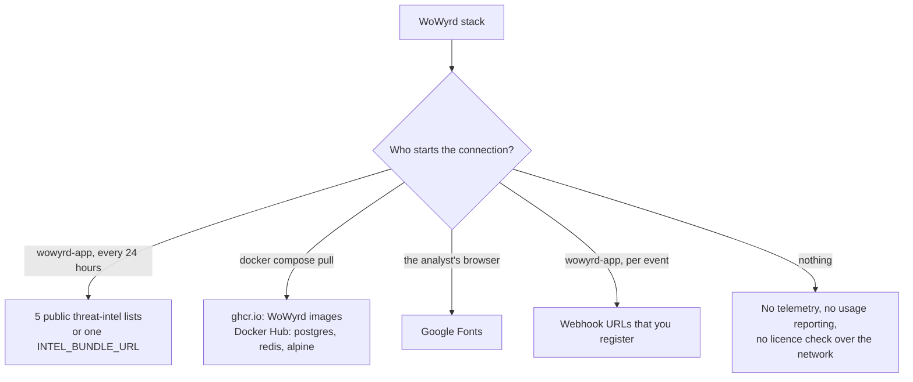

# What leaves your network

Every outbound connection that the WoWyrd stack in this repository makes, for version `0.3.5`.

## Connections

| Destination | Started by | What is sent | When | How to turn it off |
|---|---|---|---|---|
| `raw.githubusercontent.com` (IPsum IP reputation, VPN IP list, datacenter IP list, disposable-email domain list) | `wowyrd-app` | An HTTPS GET for a public file. No transaction or customer data | Each list once every 24 hours | No setting. Block the host at your firewall or proxy |
| `check.torproject.org` (Tor exit-node list) | `wowyrd-app` | The same | Once every 24 hours | The same |
| The URL in `INTEL_BUNDLE_URL` (unset by default) | `wowyrd-app` | An HTTPS GET. If a licence file is present, its content goes in the `Authorization` header: client name, licence ID, dates, limits and signature. This is sent only to the bundle URL you configure | Once every 24 hours, in place of the 5 lists above | Leave `INTEL_BUNDLE_URL` unset |
| `ghcr.io` | `docker compose pull` | Your registry token | At install and upgrade | Load the images from a file (`INSTALL.md`, step 2, option B) |
| Docker Hub (`postgres:15-alpine`, `redis:7-alpine`; `alpine:3` for the backup commands in `OPERATIONS.md`) | `docker compose pull`, `docker run` | None | At install and upgrade | Load the images from a file, or mirror them on your own registry |
| `fonts.googleapis.com`, `fonts.gstatic.com` | The analyst's browser, when it opens the dashboard | A request for font files. No transaction or customer data | Each dashboard page load | No setting. Block the hosts in the browser's network |
| Webhook URLs that you register (`POST /v1/webhooks/endpoints`) | `wowyrd-app` | The event that the webhook is subscribed to | Per event | Do not register a webhook, or delete it |

## What is not sent

- **No telemetry or usage reporting.** Neither image contains an analytics, crash-reporting or
  usage-metering library.
- **The licence check is offline.** The app checks the licence file on your host. It does not
  contact WoWyrd to do this.
- **MaxMind GeoLite2, IP2Location and the card-BIN database are local files.** The app reads them
  from `config/intel/`. It does not download them.
- **Stripe:** the app only receives Stripe callbacks. It never connects to Stripe.

## Run with no outbound connections

There is no single setting that turns off all outbound connections today. To run fully offline,
block outbound traffic at the network level. Fully offline, the IP-reputation, Tor, VPN,
datacenter and disposable-email signals have no data (see below).

1. Load the images from a file (`INSTALL.md`, step 2, option B).
2. Leave `INTEL_BUNDLE_URL` unset.
3. Block all outbound traffic from the host at your firewall or proxy.
4. Block `fonts.googleapis.com` and `fonts.gstatic.com` for the analysts' browsers, or accept that
   the browser fetches the fonts.

What happens when a list cannot be fetched in `0.3.5`:

- **The host cannot be reached (blocked, timeout, DNS failure):** the app logs a warning and keeps
  the data that it already has.
- **The host sends an HTTP error page (for example a 5xx response):** the app reads the error page
  as the list and counts the list as refreshed. It does not try again for 24 hours. The error
  page can add wrong entries. The next release fixes this.

Each list entry expires 2 days after the last successful download of its list. So if the hosts
stay blocked, the IP-reputation, Tor, VPN, datacenter and disposable-email signals have no data
after 2 days. On a new install with the hosts blocked from the start, they have no data at all.

We have not tested the dashboard with the font hosts blocked.
