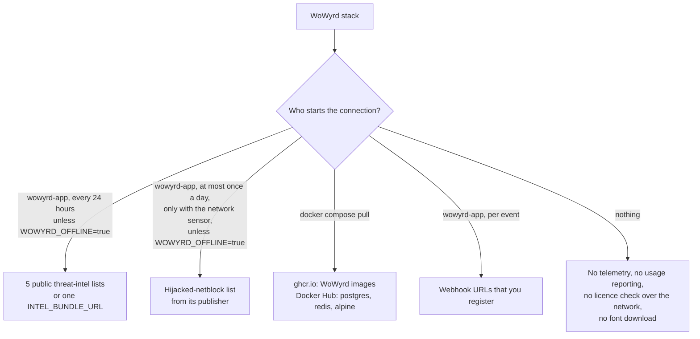
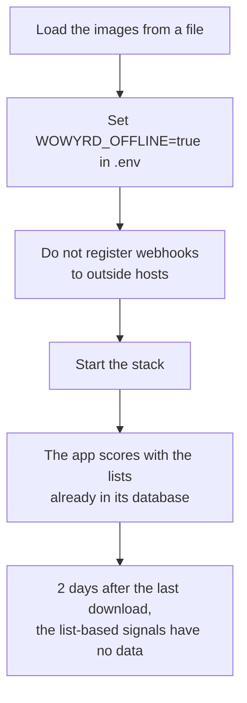
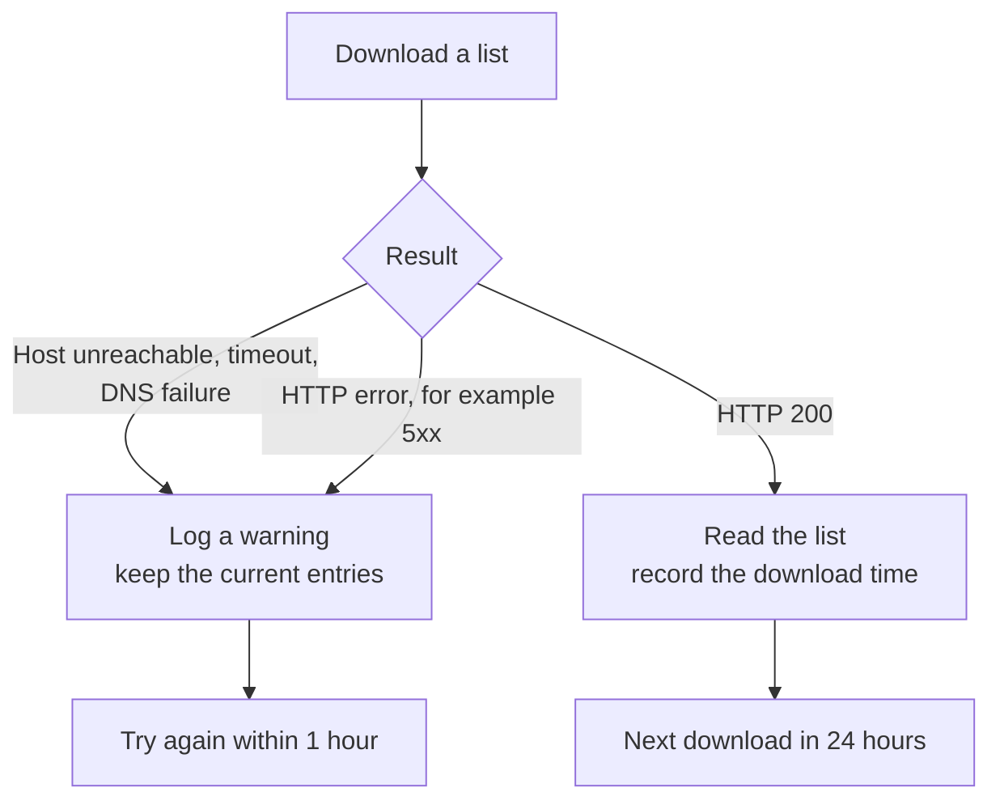

# What leaves your network

Every outbound connection that the WoWyrd stack in this repository makes, for version `0.3.10`.
For an older version, see this file in that version's release.

## Connections

| Destination | Started by | What is sent | When | How to turn it off |
|---|---|---|---|---|
| `raw.githubusercontent.com` (IPsum IP reputation, VPN IP list, datacenter IP list, disposable-email domain list) | `wowyrd-app` | An HTTPS GET for a public file. No transaction or customer data | Each list once every 24 hours | Set `WOWYRD_OFFLINE=true` |
| `check.torproject.org` (Tor exit-node list) | `wowyrd-app` | The same | Once every 24 hours | Set `WOWYRD_OFFLINE=true` |
| The URL in `INTEL_BUNDLE_URL` (unset by default) | `wowyrd-app` | An HTTPS GET. If your licence file has a bundle token, the `Authorization` header holds 3 values: the licence ID, the expiry date and the bundle token. The client name, limits and signature are not sent. With no bundle token, no `Authorization` header is sent | Once every 24 hours, in place of the 5 lists above | Leave `INTEL_BUNDLE_URL` unset, or set `WOWYRD_OFFLINE=true` |
| `www.spamhaus.org` (hijacked-netblock list, `0.3.10` or later) | `wowyrd-app` | An HTTPS GET for a public file. No transaction or customer data | At most once every 24 hours, and at least 1 hour between attempts. Only when the app connects to the network sensor (Full profile on Linux). Also when `INTEL_BUNDLE_URL` is set: the list's terms do not allow us to put it in the bundle | Set `WOWYRD_OFFLINE=true` or `WOWYRD_EBPF_DISABLE=true` |
| `ghcr.io` | `docker compose pull` | Your registry token | At install and upgrade | Load the images from a file (`INSTALL.md`, step 2, option B) |
| Docker Hub (`postgres:15-alpine`, `redis:7-alpine`; `alpine:3` for the backup commands in `OPERATIONS.md`) | `docker compose pull`, `docker run` | None | At install and upgrade | Load the images from a file, or mirror them on your own registry |
| Webhook URLs that you register (`POST /v1/webhooks/endpoints`) | `wowyrd-app` | The event that the webhook is subscribed to | Per event | Do not register a webhook, or delete it. `WOWYRD_OFFLINE=true` does not stop webhooks |

## What is not sent

- **No telemetry or usage reporting.** Neither image contains an analytics, crash-reporting or
  usage-metering library.
- **The licence check is offline.** The app checks the licence file on your host. It does not
  contact WoWyrd to do this.
- **The dashboard fonts are in the image.** The analyst's browser loads them from the dashboard,
  not from Google Fonts.
- **MaxMind GeoLite2, IP2Location and the card-BIN database are local files.** The app reads them
  from `config/intel/`. It does not download them.
- **Stripe:** the app only receives Stripe callbacks. It never connects to Stripe.

## Run with no outbound connections

1. Load the images from a file (`INSTALL.md`, step 2, option B).
2. Set `WOWYRD_OFFLINE=true` in `.env`. The app then does not download the 5 lists, the hijacked-netblock list or the bundle.
3. Do not register webhooks to hosts outside your network.
4. Start the stack. `GET /v1/license-status` shows `"offline_mode": true`, and the dashboard shows
   "Offline mode".

You can also block outbound traffic at your firewall or proxy. That is a second control, not a
replacement for step 2.

In offline mode, the app scores with the list entries that are already in its database. Each list
entry expires 2 days after the last successful download of its list. So the IP-reputation, Tor,
VPN, datacenter and disposable-email signals have no data 2 days after the app stops downloading.
On a new install that starts offline, they have no data at all.

The network sensor keeps the last Tor and hijacked-netblock lists in the kernel. A list that was
not updated for `MANAGED_TOR_MAX_LIST_AGE_HOURS` (default 72) or
`MANAGED_HIJACKED_NETBLOCK_MAX_LIST_AGE_HOURS` (default 168) stops enforcing and goes back to
`observe`. Its entries stay in place. A fresh list restores the approved mode.

## When a list cannot be fetched

- **The host cannot be reached, or sends an HTTP error (for example 5xx):** the app logs a warning,
  keeps the entries that it already has and does not count the list as refreshed. It tries again
  within 1 hour.
- **The host sends HTTP 200 with content that is not a list:** the app counts this as a download.
  The next download is in 24 hours.
- **The hijacked-netblock list** is different: the app does not use content that is not a valid
  list. The kernel keeps the previous list, and the app tries again after at least 1 hour. The app
  keeps the last valid list on disk (`THREAT_INTEL_CACHE_DIR`, a volume in `docker-compose.yml`).
  After a restart, it uses that copy if it is less than 24 hours old, and does not download.

`GET /health` shows the state of each list in `feed_health`:

- `last_success`: the time of the last successful download, or `null`.
- `stale`: `true` when there was no successful download in the last 2 days.

In offline mode, every list shows `"stale": true`, because the app does not download.
