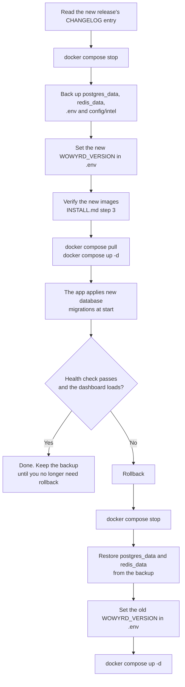
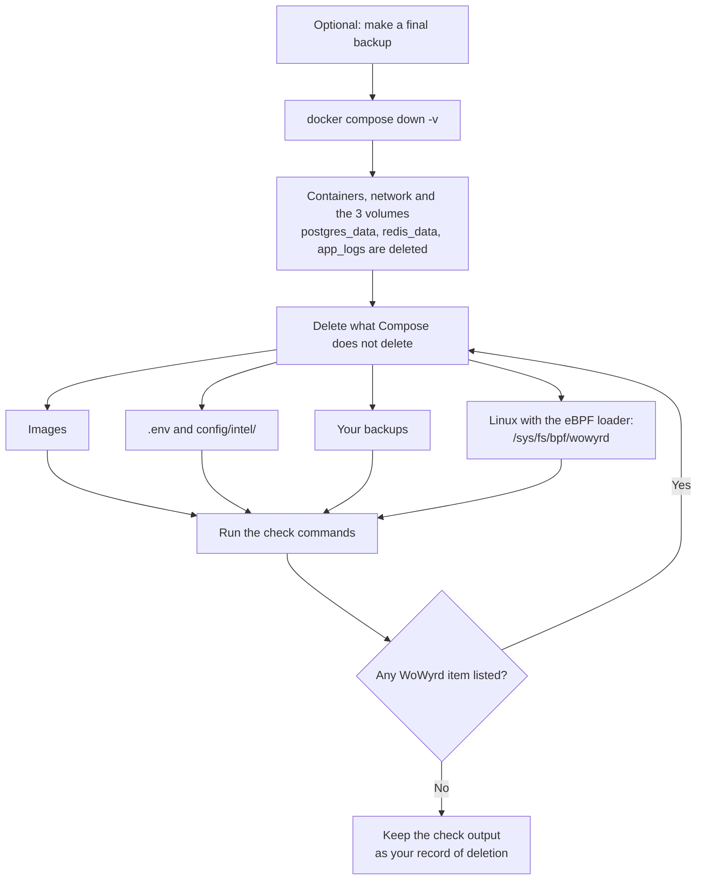

# WoWyrd — operations runbook

Upgrade, backup, rollback and uninstall for the Full profile (PostgreSQL + Redis). Install is in
[`INSTALL.md`](INSTALL.md).

## What holds your data

| Item | Where | What it holds |
|---|---|---|
| `postgres_data` volume | Docker volume | Assessments, cases, rules, reports: all WoWyrd records |
| `redis_data` volume | Docker volume | Velocity counters. Each counter expires by itself, the longest after 30 days |
| `app_logs` volume | Docker volume | Application logs |
| `.env` | Install directory | Version, passwords, API keys |
| `config/intel/` | Install directory | Optional intelligence files and the licence file |

## Upgrade, backup and rollback



### Why a backup comes before every upgrade

The app applies database migrations when it starts. Migrations only go forward. An older version
does not start on a database that a newer version has migrated. So the only rollback is a restore
of the backup that you made before the upgrade.

A restore returns the database to the time of the backup. Records written after the upgrade are
lost.

The app is stopped during the upgrade. Plan a maintenance window.

### Upgrade

1. Read the release's entry in [`CHANGELOG.md`](CHANGELOG.md) and on the Releases page.
2. Stop the stack:
   ```bash
   docker compose stop
   ```
3. Back up the two data volumes, `.env` and `config/intel/`:
   ```bash
   mkdir -p backup
   D=$(date +%Y%m%d-%H%M)
   PG_VOL=$(docker inspect wowyrd-postgres --format '{{range .Mounts}}{{.Name}}{{end}}')
   REDIS_VOL=$(docker inspect wowyrd-redis --format '{{range .Mounts}}{{.Name}}{{end}}')
   docker run --rm -v "$PG_VOL":/v:ro -v "$PWD/backup":/b alpine:3 tar -C /v -czf /b/postgres_data-$D.tgz .
   docker run --rm -v "$REDIS_VOL":/v:ro -v "$PWD/backup":/b alpine:3 tar -C /v -czf /b/redis_data-$D.tgz .
   tar -czf backup/config-$D.tgz .env config/
   ```
   `backup/` holds your secrets and your data. Store it as you store the database itself.
4. Set the new version in `.env`, for example `WOWYRD_VERSION=0.3.6`.
5. Verify the new images, as in `INSTALL.md` step 3.
6. Pull and start:
   ```bash
   docker compose pull
   docker compose up -d
   ```
7. Check the result:
   ```bash
   docker compose ps
   curl http://localhost:8090/health
   docker compose logs wowyrd-app | grep -i migration
   ```

### Rollback

1. Stop the stack:
   ```bash
   docker compose stop
   ```
2. Restore both volumes from the backup. Set `D` to the date part of the backup file names:
   ```bash
   D=20261024-1530    # example
   PG_VOL=$(docker inspect wowyrd-postgres --format '{{range .Mounts}}{{.Name}}{{end}}')
   REDIS_VOL=$(docker inspect wowyrd-redis --format '{{range .Mounts}}{{.Name}}{{end}}')
   docker run --rm -v "$PG_VOL":/v -v "$PWD/backup":/b:ro alpine:3 \
     sh -c 'find /v -mindepth 1 -delete && tar -C /v -xzf /b/postgres_data-'"$D"'.tgz'
   docker run --rm -v "$REDIS_VOL":/v -v "$PWD/backup":/b:ro alpine:3 \
     sh -c 'find /v -mindepth 1 -delete && tar -C /v -xzf /b/redis_data-'"$D"'.tgz'
   ```
3. Set the old version in `.env`.
4. Start:
   ```bash
   docker compose up -d
   ```

## Uninstall



1. Optional: make a final backup (Upgrade, step 3).
2. Delete the containers, the network and the data volumes. Use the same `-f` files that you
   used to start the stack:
   ```bash
   docker compose down -v
   # Lite:  docker compose -f docker-compose.yml -f docker-compose.lite.yml down -v
   # macOS: docker compose -f docker-compose.yml -f docker-compose.macos.yml down -v
   ```
3. Delete the images:
   ```bash
   docker image ls --format '{{.Repository}}:{{.Tag}}' | grep '^ghcr.io/chavychaze/' | xargs -r docker image rm
   ```
   `postgres:15-alpine`, `redis:7-alpine` and `alpine:3` are public images. Delete them only if
   nothing else on the host uses them.
4. Delete `.env`, `config/intel/` and every backup that you made.
5. Linux only: if the stack ran with eBPF, the host can keep pinned maps under
   `/sys/fs/bpf/wowyrd` after the containers are gone. The loader does not unpin its maps when it
   stops. Delete them:
   ```bash
   sudo rm -rf /sys/fs/bpf/wowyrd
   ```
   A reboot also clears them.
6. Check. Each command must print nothing:
   ```bash
   docker ps -a --filter name=wowyrd --format '{{.Names}}'
   docker volume ls --format '{{.Name}}' | grep -E 'postgres_data|redis_data|app_logs|wowyrd_lite_data'
   docker image ls --format '{{.Repository}}:{{.Tag}}' | grep chavychaze
   ls -d /sys/fs/bpf/wowyrd 2>/dev/null
   ```

Keep the check output as your record of deletion. If your contract requires a deletion
confirmation, send the output to WoWyrd. WoWyrd replies in writing that it received it. The reply
also lists any pilot material that WoWyrd itself holds (for example, reports you shared) and what
happens to it.
