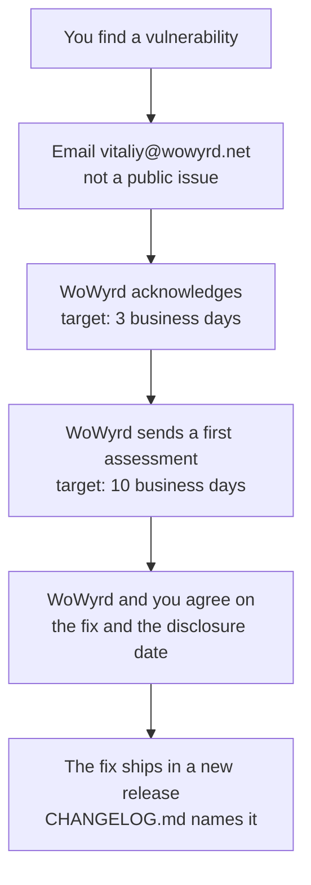

<!-- TODO: switch the address to security@wowyrd.net once that mailbox or alias exists. -->

# Security policy

## Report a vulnerability

1. Email **vitaliy@wowyrd.net**. Start the subject with `Security:`.
2. Do not open a public GitHub issue for a vulnerability.
3. Include:
   - the WoWyrd version (`WOWYRD_VERSION`);
   - the steps to reproduce the problem;
   - what an attacker can do with it;
   - your name or handle, if you want credit.

## What we do and when

| Step | Target |
|---|---|
| Acknowledge your report | Within 3 business days |
| Send a first assessment | Within 10 business days |

Business days are Ukrainian working days, in the Europe/Kyiv time zone.

These are targets, not guarantees. We do not promise a fix date. After the first assessment, we
agree with you on the fix and on when the issue becomes public.

## Scope

- The `wowyrd-app` and `wowyrd-dashboard` images on `ghcr.io/chavychaze`.
- The Compose files and the documentation in this repository.

Report a vulnerability in PostgreSQL, Redis or Docker to that project directly.
